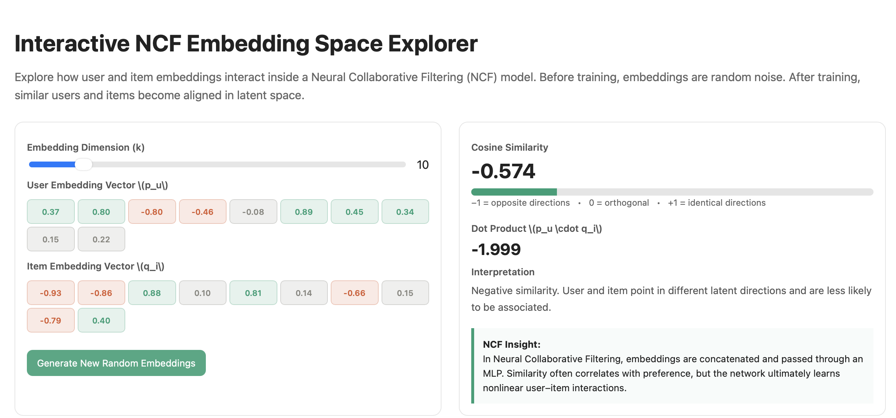

# The Mathematics Must Know Cold

The following mathematical concepts form the foundation of Neural Collaborative Filtering and appear directly in the manual backpropagation implementation developed in this project. Every gradient computation in the training loop can be traced back to one of these equations.

---

## Chain Rule: The Engine of Backpropagation

Backpropagation is fundamentally an application of the chain rule from calculus.

If a loss function \(L\) depends on an intermediate variable \(z\), which in turn depends on parameters \(W\), then:

\[
\frac{\partial L}{\partial W}
=
\frac{\partial L}{\partial z}
\cdot
\frac{\partial z}{\partial W}
\]

Each layer applies this rule repeatedly, propagating gradients from the output layer back toward the input layer.

In the NumPy implementation, every weight update ultimately relies on this recursive application of the chain rule.

---

## Sigmoid Activation Derivative

The sigmoid activation function is used in the output layer to convert raw scores into probabilities.

\[
\sigma(x)
=
\frac{1}{1 + e^{-x}}
\]

Its derivative is:

\[
\frac{d\sigma}{dx}
=
\sigma(x)
\bigl(1-\sigma(x)\bigr)
\]

A notable property is that the derivative can be computed directly from the sigmoid output itself, making it computationally efficient.

---

## ReLU Activation Derivative

The Rectified Linear Unit (ReLU) is used throughout the hidden layers.

\[
\text{ReLU}(x)
=
\max(0,x)
\]

Its derivative is:

\[
\frac{d}{dx}\text{ReLU}(x)
=
\begin{cases}
1, & x > 0 \\
0, & x \leq 0
\end{cases}
\]

This simple derivative contributes to the efficiency and effectiveness of deep neural networks.

---

## Binary Cross Entropy Gradient

The Binary Cross Entropy (BCE) loss function is defined as:

\[
L(y,\hat{y})
=

- \Big[
  y\log(\hat{y})

* (1-y)\log(1-\hat{y})
  \Big]
  \]

Differentiating with respect to the prediction \(\hat{y}\):

\[
\frac{\partial L}{\partial \hat{y}}
=
-\frac{y}{\hat{y}}

- \frac{1-y}{1-\hat{y}}
  \]

Special cases:

### Positive Interaction (\(y=1\))

\[
\frac{\partial L}{\partial \hat{y}}
=
-\frac{1}{\hat{y}}
\]

### Negative Interaction (\(y=0\))

\[
\frac{\partial L}{\partial \hat{y}}
=
\frac{1}{1-\hat{y}}
\]

When BCE is combined with a sigmoid output layer, the expression simplifies elegantly to:

\[
\delta
=
\hat{y}

- y
  \]

This simplified gradient is used directly during backpropagation.

---

## Matrix Gradients for a Linear Layer

Consider a linear transformation:

\[
z = Wx + b
\]

where:

- \(W\) is the weight matrix
- \(x\) is the input vector
- \(b\) is the bias vector

Let

\[
\delta
=
\frac{\partial L}{\partial z}
\]

represent the incoming gradient.

The required gradients become:

### Weight Gradient

\[
\frac{\partial L}{\partial W}
=
\delta x^{T}
\]

This is an outer product and has the same shape as \(W\).

### Bias Gradient

\[
\frac{\partial L}{\partial b}
=
\delta
\]

### Input Gradient

\[
\frac{\partial L}{\partial x}
=
W^{T}\delta
\]

This gradient is propagated backward to the previous layer.

These equations form the mathematical basis for every parameter update in the scratch implementation.

---

# Interactive: Explore Embedding Space

The visualization below demonstrates how user and item embeddings evolve during training.

Before training:

- Embeddings are initialized randomly.
- Distances between vectors have no semantic meaning.
- Similarity relationships are essentially noise.

After training:

- Users with similar preferences occupy nearby regions in embedding space.
- Items with similar interaction patterns become clustered together.
- User vectors begin aligning with items they are likely to interact with.
- The MLP learns higher-order nonlinear relationships on top of these learned embeddings.

## Interactive Embedding Visualization

## Interactive Embedding Visualization

🔗 **Open Interactive Visualization**

[Launch Embedding Space Explorer](interactive/embedding_space.html)

Figure: Interactive embedding-space visualization. Open the HTML file to explore user and item embeddings, cosine similarity, and latent-space relationships.
