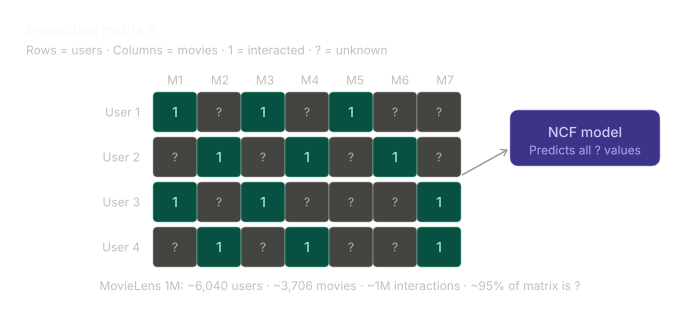

# Collaborative Filtering

Collaborative Filtering is based on a simple but powerful insight:

> Users who exhibited similar preferences in the past are likely to exhibit similar preferences in the future.

Unlike content-based recommendation systems, collaborative filtering does not require any knowledge about the items themselves (e.g., movie genres, actors, directors, or descriptions). Instead, it relies solely on interaction patterns between users and items — such as ratings, purchases, clicks, or watch history.

## User–Item Interaction Matrix

The interactions can be represented as a user–item matrix:

| User   | Movie A | Movie B | Movie C | Movie D |
| ------ | ------- | ------- | ------- | ------- |
| User 1 | ✓       | ?       | ✓       | ?       |
| User 2 | ✓       | ✓       | ?       | ?       |
| User 3 | ?       | ✓       | ?       | ✓       |
| User 4 | ✓       | ?       | ?       | ✓       |

- **✓** = observed interaction
- **?** = unknown interaction

### Figure: Sparse User–Item Interaction Matrix

_Figure: Visualization of a sparse user–item interaction matrix. Most entries are unknown, requiring the recommendation model to infer missing preferences._

## Why Recommendation Is Difficult

A critical characteristic of real-world recommendation datasets is **sparsity**.

In the **MovieLens 1M** dataset, approximately **95% of the user–item matrix consists of unknown entries (?)**. This means that the model directly observes only about **5% of all possible interactions**.

As a result:

- The model is trained on a very small fraction of available user–item relationships.
- Most preferences must be inferred rather than observed.
- The system must generalize from limited evidence to predict unseen interactions.

This extreme sparsity is one of the primary challenges in recommendation systems and explains why simple heuristic approaches often perform poorly. Successful recommendation models must learn meaningful latent patterns from sparse interaction data and accurately estimate user preferences for items they have never interacted with before.
