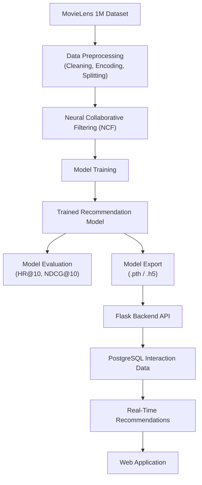
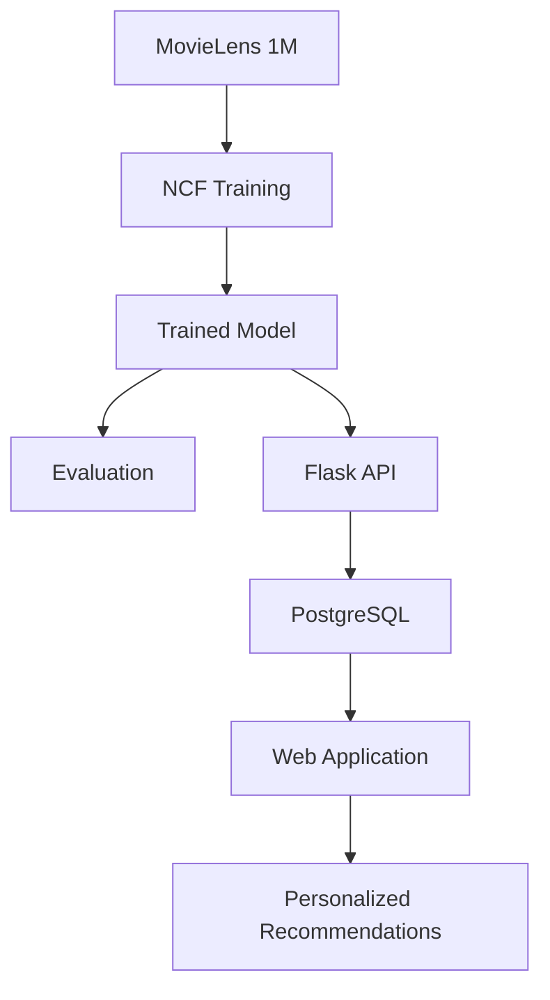

# The Data Pipeline Overview

We have two data sources. Understanding why you need both is important for your thesis.

**MovieLens 1M** is your primary training source — real human preferences, academically validated, and directly comparable to published NCF results.

The **synthetic PostgreSQL dataset** serves a different purpose: it powers the live web application and demonstrates that your system can ingest interaction data from a production database, not just a CSV file.

This distinction is important for **Chapter 3 (System Design)** of the thesis.

## Understanding the Raw MovieLens Data

Before writing a single line of code, inspect the raw dataset format.

Run:

```bash
head -5 ml-1m/ratings.dat
```

You will see output similar to:

```text
1::1193::5::978300760
1::661::3::978302109
1::914::3::978301968
1::3408::4::978300275
1::2355::5::978824291
```

The separator is **`::`**, not a comma.

The columns are:

```text
UserID::MovieID::Rating::Timestamp
```

| Column    | Description                  |
| --------- | ---------------------------- |
| UserID    | Unique user identifier       |
| MovieID   | Unique movie identifier      |
| Rating    | User rating (1–5)            |
| Timestamp | Unix timestamp of the rating |

### First Data Engineering Gotcha

A common mistake is assuming the file is a standard CSV.

For example:

```python
pd.read_csv("ratings.dat", sep=",")
```

This will silently produce incorrect data because MovieLens 1M does **not** use commas as separators.

The correct approach is:

```python
ratings = pd.read_csv(
    "ratings.dat",
    sep="::",
    engine="python",
    names=["UserID", "MovieID", "Rating", "Timestamp"]
)
```

### Key Lesson

Always inspect raw files before building preprocessing pipelines.

Simple commands such as:

```bash
head -5 ratings.dat
```

or

```bash
cat ratings.dat | head
```

can reveal delimiter formats, missing headers, encoding issues, and other data-quality problems that would otherwise propagate through the entire machine learning pipeline.

---

## Full Data Pipeline





## Purpose of Each Data Source

### 1. MovieLens 1M Dataset

Used for:

- Training the NCF model
- Validation and testing
- Benchmark comparison with published research
- Measuring recommendation quality

Advantages:

- Real user ratings
- Widely used in recommendation system research
- Reproducible experimental results

### 2. Synthetic PostgreSQL Dataset

Used for:

- Running the live application
- Simulating production user interactions
- Storing:
  - Users
  - Movies
  - Ratings
  - Clicks
  - Watch history

Advantages:

- Demonstrates database integration
- Mimics a real-world deployment environment
- Supports API-driven recommendation serving

## Why Use Both?

Using only MovieLens would demonstrate the recommendation algorithm but not a deployable system.

Using only PostgreSQL synthetic data would demonstrate system integration but would lack a recognized benchmark dataset for academic evaluation.

Therefore:

- **MovieLens 1M = Research Dataset**
- **PostgreSQL Dataset = Production Dataset**

This combination allows the project to satisfy both:

1. **Academic requirements** (algorithm evaluation)
2. **Software engineering requirements** (real-world deployment)

## Thesis Perspective

From a thesis standpoint:

### Research Layer

- Dataset: MovieLens 1M
- Algorithm: Neural Collaborative Filtering (NCF)
- Evaluation Metrics:
  - Hit Ratio @ 10 (HR@10)
  - Normalized Discounted Cumulative Gain @ 10 (NDCG@10)

### Application Layer

- Backend: Flask
- Database: PostgreSQL
- Frontend: Web Application
- Recommendation Serving: REST API

## Final Architecture


