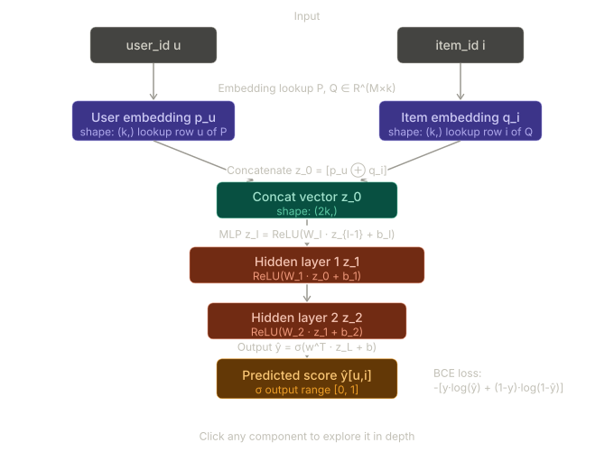

# The Mathematics of Neural Collaborative Filtering (NCF)

This section presents the mathematical formulation of Neural Collaborative Filtering (NCF), the recommendation model used throughout this project.

## Problem Setup

Let:

- \(U = \{1, 2, \ldots, M\}\) denote the set of users.
- \(I = \{1, 2, \ldots, N\}\) denote the set of items.

The user–item interactions are represented by an implicit feedback matrix:

\[
Y \in \{0,1\}^{M \times N}
\]

where

\[
Y\_{u,i} =
\begin{cases}
1, & \text{if user } u \text{ interacted with item } i \\
0, & \text{otherwise}
\end{cases}
\]

- Y[u,i] = 1 if user u interacted with item i

- Y[u,i] = 0 otherwise (unobserved — not necessarily negative)

Unlike explicit rating systems, a value of \(0\) does **not** indicate dislike. It simply means that no interaction has been observed. This formulation is known as **implicit feedback learning** and is widely used in modern recommendation systems.

---

## Neural Collaborative Filtering Function

The objective is to learn a function

\[
\hat{y}\_{u,i} = f(u,i \mid \Theta)
\]

where:

- \(f\) is a neural network parameterized by \(\Theta\)
- \(\hat{y}\_{u,i} \in [0,1]\)
- \(\hat{y}\_{u,i}\) represents the predicted probability that user \(u\) will interact with item \(i\)

---

## Architecture Construction

Neural Collaborative Filtering learns latent representations for both users and items and combines them through a deep neural network.

### Step 1: Embedding Lookup

Each user and item is mapped to a dense latent vector:

\[
p_u = P[u,:]
\]

\[
q_i = Q[i,:]
\]

where:

- \(P \in \mathbb{R}^{M \times k}\) is the user embedding matrix
- \(Q \in \mathbb{R}^{N \times k}\) is the item embedding matrix
- \(k\) is the embedding dimension

The vectors \(p_u\) and \(q_i\) capture latent preferences and characteristics learned during training.

---

### Step 2: Concatenation

The user and item embeddings are concatenated:

\[
z_0 = p_u \oplus q_i
\]

where:

- \(\oplus\) denotes vector concatenation
- \(z_0 \in \mathbb{R}^{2k}\)

---

### Step 3: Multi-Layer Perceptron (MLP)

The concatenated representation is passed through multiple hidden layers:

\[
z_1 = \text{ReLU}(W_1 z_0 + b_1)
\]

\[
z_2 = \text{ReLU}(W_2 z_1 + b_2)
\]

\[
\vdots
\]

\[
z*L = \text{ReLU}(W_L z*{L-1} + b_L)
\]

where:

- \(W_l\) are learnable weight matrices
- \(b_l\) are bias vectors
- ReLU is the activation function

The hidden layers learn increasingly complex nonlinear interactions between users and items.

---

### Step 4: Prediction Layer

The final hidden representation is transformed into a probability score:

\[
\hat{y}_{u,i} =
\sigma
\left(
w^{T} z_L + b_{out}
\right)
\]

where:

- \(w\) is the output weight vector
- \(b\_{out}\) is the output bias
- \(\sigma(\cdot)\) is the sigmoid activation function

The sigmoid function ensures:

\[
0 \leq \hat{y}\_{u,i} \leq 1
\]

allowing the output to be interpreted as a probability.

---

## Loss Function

Because recommendation is formulated as a binary prediction problem, Binary Cross Entropy (BCE) is used as the optimization objective.

For a single training sample:

\[
L(y,\hat{y})
=
-\Big[
y\log(\hat{y})

- (1-y)\log(1-\hat{y})
  \Big]
  \]

where:

- \(y\) is the true interaction label
- \(\hat{y}\) is the predicted probability

---

## Negative Sampling Objective

In implicit-feedback datasets, only positive interactions are observed directly.

To train the model effectively, negative samples are generated from unobserved interactions.

The overall training objective becomes:

\[
L\_{total}
=

- \sum*{(u,i)\in Y^{+}}
  \log(\hat{y}*{u,i})
- \sum*{(u,j)\in Y^{-}}
  \log(1-\hat{y}*{u,j})
  \]

where:

- \(Y^{+}\) represents observed positive interactions
- \(Y^{-}\) represents sampled negative interactions

A common practice is to sample **four negative examples for every positive interaction**, producing a balanced and computationally efficient training set.

---

## NCF Architecture Visualization

_Figure 2: Neural Collaborative Filtering architecture. User and item IDs are transformed into latent embeddings, concatenated, processed through multiple fully connected layers, and finally mapped to an interaction probability using a sigmoid output layer._
