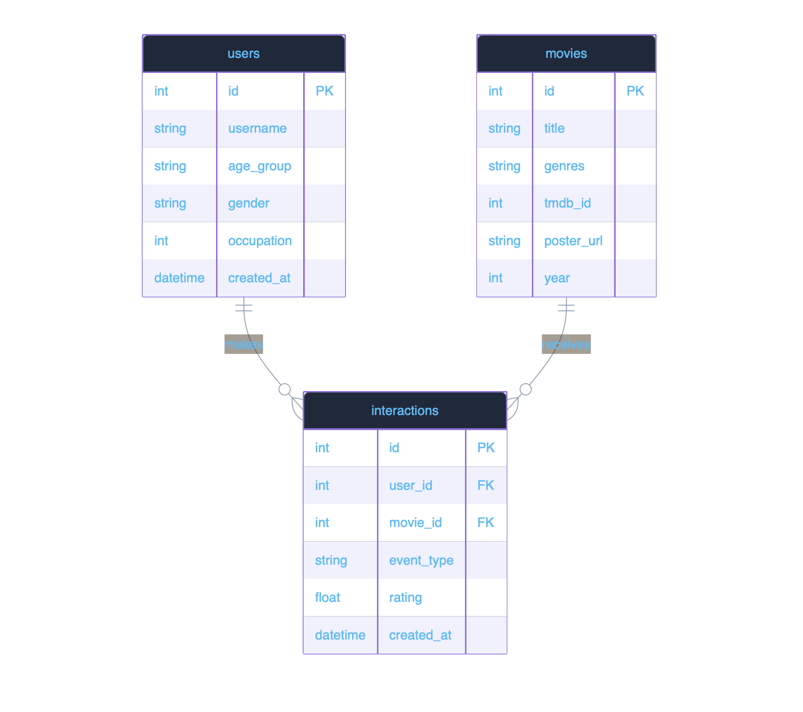

## PostgreSQL ERD

The PostgreSQL Entity Relationship Diagram (ERD) represents the complete database schema used in this project. This diagram should be referenced in the thesis as:

## Database Schema Preview



---

## Interactive PostgreSQL ERD

🔗 **Open Interactive Database Schema**

[Launch PostgreSQL ERD Explorer](interactive/postgresql_erd.html)

---

### Key Design Decisions

The database schema was designed to support efficient data preprocessing, recommendation model training, and future application features.

#### 1. Movie ID Mapping

The `movie.id` column intentionally matches the MovieLens `item_id`.

**Reason:**

- Enables both datasets to use the same re-indexed movie IDs.
- Eliminates the need for additional joins during preprocessing.
- Simplifies embedding lookup during Neural Collaborative Filtering (NCF) training.
- Reduces preprocessing complexity and improves runtime efficiency.

---

#### 2. Event Type

The `event_type` field differentiates user interactions such as:

- Like
- Click
- Rating

**Reason:**

Different user interactions carry different levels of importance.

During **Phase 5 (Hybrid Recommendation Engine)**, these interaction types will receive different weights when calculating recommendation scores.

Example:

| Event  | Importance |
| ------ | ---------- |
| Click  | Low        |
| Like   | Medium     |
| Rating | High       |

This design allows future recommendation algorithms to incorporate richer user behavior beyond explicit ratings.

---

#### 3. Nullable Poster URL

The `poster_url` column is defined as **nullable**.

**Reason:**

Movie posters are not downloaded during the initial data loading process.

Instead, poster images are retrieved lazily from **TMDB (The Movie Database)** whenever required.

Benefits include:

- Faster database seeding
- Smaller database size
- Reduced external API requests
- Improved application startup performance

---

## Data Processing

- [ ] `python data/movielens_loader.py` executes without errors.
- [ ] `data/processed/` contains:
  - `train.csv`
  - `val.csv`
  - `test.csv`
  - `train_users.npy`
  - `train_items.npy`
  - `train_labels.npy`
  - `meta.json`

---

## Dataset Statistics

Verify that `meta.json` contains:

- **Number of users:** `6040`
- **Number of items:** `3706`

---

## Test Dataset

Confirm that:

- Test dataset contains **exactly 6,040 rows**
- One test interaction exists for every user.

---

## Training Dataset

Verify that the training dataset maintains a:

- **Positive : Negative ratio = 1 : 4**

This negative sampling strategy is consistent with the original Neural Collaborative Filtering methodology.

---

## Database

Confirm that:

- PostgreSQL Docker container is running.

Example:

```bash
docker ps
```

The output should include:

```text
ncf-postgres
```

---

## Database Seeding

Execute:

```bash
python -m backend.app.db.seed
```

Ensure the command completes without any errors.

---

# Conceptual Understanding

Before moving to the next phase, ensure the following concepts are understood.

## Why Re-index IDs?

Embedding layers require contiguous integer indices beginning at zero.

Original MovieLens IDs are sparse and non-contiguous, making them inefficient for embedding matrix lookup.

Re-indexing provides:

- Continuous integer IDs
- Smaller embedding matrices
- Faster indexing
- Reduced memory consumption

---

## Why Leave-One-Out Evaluation?

Leave-one-out evaluation is the standard evaluation protocol used in the original Neural Collaborative Filtering (NCF) research.

For each user:

- One interaction is reserved as the test sample.
- Remaining interactions are used for training.
- The recommender attempts to rank the held-out item among negative samples.

Advantages include:

- Fair comparison with published NCF results.
- Consistent benchmarking across recommendation systems.
- Reliable Top-K evaluation metrics (Hit Ratio and NDCG).

---
