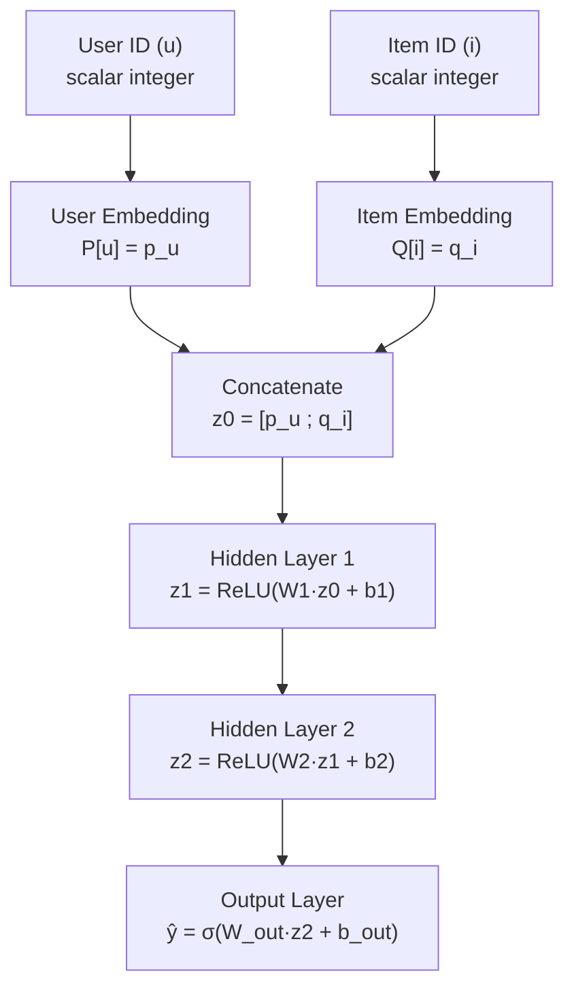
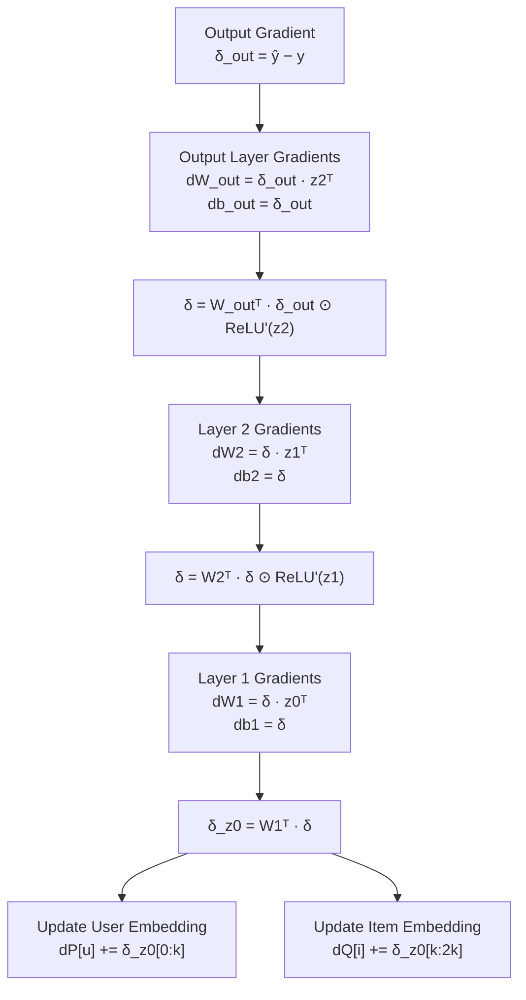

# NCF from Scratch (NumPy)

> **This is the heart of the thesis.**
>
> Every matrix multiplication, gradient computation, and weight update is implemented manually using **NumPy**. Unlike high-level frameworks that simply call `model.fit()`, this implementation exposes every mathematical operation behind Neural Collaborative Filtering (NCF).
>
> Build the model in the following order:
>
> ```
> Embeddings
>      ↓
> Forward Pass
>      ↓
> Loss Function
>      ↓
> Backpropagation
>      ↓
> Optimizer
>      ↓
> Training Loop
> ```
>
> Each module corresponds directly to a file inside:
>
> ```text
> models/
> └── scratch_ncf/
>     ├── embeddings.py
>     ├── forward.py
>     ├── loss.py
>     ├── backward.py
>     ├── optimizer.py
>     └── trainer.py
> ```

---

# 3.1 The Computation Graph

Before writing any code, it is important to understand **how data flows through the network** during the forward pass and **how gradients travel backward** during backpropagation.

Think of the network as a graph.

- During the **forward pass**, information moves from the input embeddings toward the prediction.
- During the **backward pass**, gradients move in the opposite direction to update every trainable parameter.

Every forward operation has a corresponding gradient computation during backpropagation.

---

# Forward Pass

The model receives two IDs:

- User ID `u`
- Item ID `i`

These IDs are used to retrieve their embedding vectors from the embedding matrices.



---

## Step-by-Step

### 1. Lookup Embeddings

The embedding matrices contain latent representations.

```text
P ∈ R^(num_users × k)

Q ∈ R^(num_items × k)
```

For one training sample:

```text
p_u = P[u]

q_i = Q[i]
```

Each embedding has shape:

```text
(k,)
```

---

### 2. Concatenate

Both embeddings are merged into one feature vector.

```text
z0 = concat(p_u, q_i)
```

Resulting shape:

```text
(2k,)
```

No parameters are learned here.

---

### 3. Hidden Layer 1

Linear transformation followed by ReLU.

```text
z1 = ReLU(W1z0 + b1)
```

Parameter shapes:

```text
W1 : (h1, 2k)

b1 : (h1,)
```

---

### 4. Hidden Layer 2

```text
z2 = ReLU(W2z1 + b2)
```

Parameter shapes:

```text
W2 : (h2, h1)

b2 : (h2,)
```

---

### 5. Output Layer

Predict the probability that the user interacts with the item.

```text
ŷ = σ(W_out z2 + b_out)
```

Output:

```text
ŷ ∈ [0,1]
```

---

# Binary Cross Entropy Loss

For a single training sample,

```math
L = -\left(y\log(\hat{y}) + (1-y)\log(1-\hat{y})\right)
```

where

- `y = 1` → positive interaction
- `y = 0` → negative sample

---

# Backward Pass

Backpropagation computes gradients in the reverse order.

The gradient begins at the output layer and propagates backward until it reaches the embedding matrices.



---

# Step-by-Step Gradient Flow

## Output Layer

For Binary Cross Entropy combined with Sigmoid,

```text
δ_out = ŷ − y
```

Weight gradients:

```text
dW_out = δ_out · z2ᵀ

db_out = δ_out
```

---

## Layer 2

Propagate gradient through ReLU.

```text
δ = W_outᵀδ_out ⊙ ReLU'(z2)
```

Compute gradients:

```text
dW2 = δ · z1ᵀ

db2 = δ
```

---

## Layer 1

Continue propagating.

```text
δ = W2ᵀδ ⊙ ReLU'(z1)
```

Gradients:

```text
dW1 = δ · z0ᵀ

db1 = δ
```

---

## Embedding Layer

Finally,

```text
δ_z0 = W1ᵀδ
```

Split the gradient into two parts.

User embedding:

```text
dP[u] += δ_z0[:k]
```

Item embedding:

```text
dQ[i] += δ_z0[k:]
```

---

# Why Embedding Layers Are Efficient

Unlike dense neural network layers, embedding matrices are **sparsely updated**.

For every training sample:

- Only one user embedding is accessed.
- Only one item embedding is accessed.

Instead of updating the entire matrices,

```text
P (num_users × k)

Q (num_items × k)
```

only the selected rows are modified:

```text
P[u]

Q[i]
```

This dramatically reduces computation and memory usage, making embedding layers highly scalable for recommendation systems with millions of users and items.

---

# Complete Pipeline

```text
User ID + Item ID
        │
        ▼
Embedding Lookup
        │
        ▼
Concatenate Embeddings
        │
        ▼
Hidden Layer 1 (ReLU)
        │
        ▼
Hidden Layer 2 (ReLU)
        │
        ▼
Sigmoid Output
        │
        ▼
Binary Cross Entropy Loss
        │
        ▼
Backpropagation
        │
        ▼
Compute Gradients
        │
        ▼
Update:
• User Embedding
• Item Embedding
• W1
• b1
• W2
• b2
• W_out
• b_out
        │
        ▼
Next Training Sample
```

---

## Key Takeaways

- NCF learns **latent user and item representations** through embedding matrices.
- The forward pass transforms embeddings into an interaction probability using a multilayer perceptron (MLP).
- Binary Cross Entropy measures prediction error.
- Backpropagation computes gradients for every trainable parameter.
- Only the active user and item embedding vectors are updated, making embedding layers computationally efficient.
- Understanding this computation graph is essential before implementing the NumPy code for forward propagation, backpropagation, optimization, and the complete training loop.
