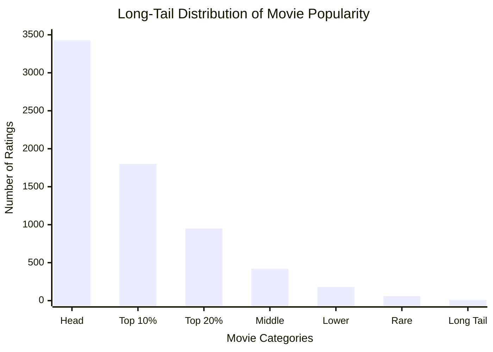
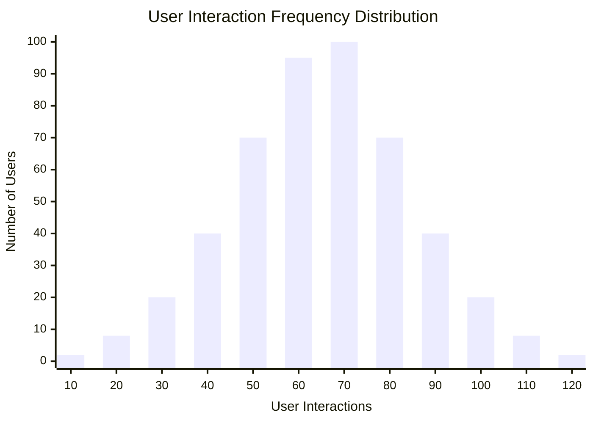

# Developer Reference Note: Simulating Realistic Interaction Patterns

**File:** `backend/app/db/seed.py`
**Target Function:** `seed_interactions(db: Session)`

---

# 1. Overview & Architectural Purpose

The `seed_interactions` function is responsible for populating the database with a synthetic dataset of user-movie interactions. Rather than utilizing flat, uniform randomness—which would fail to train or evaluate a recommendation model effectively—this code applies mathematical distributions to engineer a high-fidelity simulator of real-world consumer behavior.

## High-Level Flow

1. **Idempotency Check** – Skips execution if interactions already exist.
2. **Global State Retrieval** – Loads all movie and user identifiers from the database.
3. **Imbalance Modeling** – Generates movie popularity distributions using Zipf's Law (Power Law).
4. **Behavior Simulation** – Creates realistic user activity patterns.
5. **Temporal Distribution** – Spreads interactions across historical timestamps.
6. **Bulk Persistence** – Inserts all generated records efficiently.

---

# 2. Deep-Dive Mathematical Engineering

## A. Power-Law Popularity (Zipf Distribution)

Real-world content platforms exhibit an extreme imbalance in consumption patterns. A small percentage of movies account for the majority of user engagement.

This phenomenon is commonly called the **Long Tail Distribution**.

```python
popularity = np.random.zipf(1.5, len(movie_ids))
popularity = popularity / popularity.sum()
```

### Mathematical Foundation

Zipf's Law:

[
P(x) \propto x^{-a}
]

where:

- (P(x)) = probability of item x being selected
- (a) = distribution shape parameter
- Larger values create steeper popularity concentration

### Example

| Movie               | Relative Popularity |
| ------------------- | ------------------- |
| Movie A             | 40%                 |
| Movie B             | 20%                 |
| Movie C             | 10%                 |
| Movie D             | 5%                  |
| Remaining 96 Movies | 25%                 |

This mirrors platforms such as Netflix, YouTube, Spotify, and Amazon where a few items dominate user attention.

### Visualization



---

## B. User Activity Variance (Gaussian / Normal Distribution)

Not all users consume content equally.

Some users interact only occasionally, while others become highly active power users.

```python
n_interactions = max(
    10,
    int(np.random.normal(INTERACTIONS_PER_USER_MEAN, 20))
)
```

### Mathematical Foundation

Normal Distribution:

[
X \sim N(\mu,\sigma^2)
]

where:

- (\mu) = average interactions per user
- (\sigma) = standard deviation
- Most users cluster around the mean
- Fewer users exist at both extremes

---

### Bell Curve Visualization

Example:



### Interpretation

For:

```python
np.random.normal(60, 20)
```

- Mean = 60 interactions
- Standard Deviation = 20

Typical distribution:

| User Type   | Interactions |
| ----------- | ------------ |
| Very Casual | 10–30        |
| Casual      | 30–50        |
| Average     | 50–70        |
| Active      | 70–90        |
| Power User  | 90–120+      |

Most users will fall near 60 interactions, while only a small fraction become power users.

### Why Use a Bell Curve?

If every user generated exactly 60 interactions:

```python
60, 60, 60, 60, 60, 60 ...
```

the recommendation model would learn unrealistic behavior.

The Gaussian distribution introduces natural variability:

```python
42, 55, 61, 89, 70, 36, 112 ...
```

which better reflects real-world engagement patterns.

### Guardrail

```python
max(10, ...)
```

ensures:

- No negative values
- No extremely sparse users
- Minimum profile density remains sufficient for recommendation training

---

# 3. Interaction Mechanics & Behavioral Emulation

## Behavioral Modeling Matrix

| Code Block                                           | Sub-System Emulated    | Implementation Detail                                                            |
| ---------------------------------------------------- | ---------------------- | -------------------------------------------------------------------------------- |
| `np.random.choice(..., replace=False, p=popularity)` | Content Selection      | Popular movies receive higher selection probability while preventing duplicates. |
| `random.choices(..., weights=[0.4,0.4,0.2])`         | Action Diversification | Simulates user engagement patterns.                                              |
| `random.uniform(3.0,5.0)`                            | Rating Bias            | Users generally rate content they enjoy.                                         |
| `now - timedelta(...)`                               | Historical Backdating  | Creates realistic temporal interaction histories.                                |

---

## Content Selection

```python
chosen = np.random.choice(
    movie_ids,
    size=min(n_interactions, len(movie_ids)),
    replace=False,
    p=popularity
)
```

### Why `replace=False`?

Without it:

```text
Movie 25
Movie 25
Movie 25
Movie 25
```

A user could interact with the same movie repeatedly during seeding.

With `replace=False`:

```text
Movie 25
Movie 41
Movie 89
Movie 12
```

Each selected movie remains unique.

---

## Action Diversification

```python
event_type = random.choices(
    ["click", "like", "rate"],
    weights=[0.4, 0.4, 0.2]
)[0]
```

### Distribution

| Event | Probability |
| ----- | ----------- |
| Click | 40%         |
| Like  | 40%         |
| Rate  | 20%         |

This reflects real-world friction levels:

- Clicking is easy
- Liking requires more engagement
- Rating requires the most effort

---

## Rating Bias

```python
rating = random.uniform(3.0, 5.0)
```

Humans rarely rate content they dislike.

Typical production datasets exhibit positive rating skew.

Example:

```text
★★★★★
★★★★☆
★★★★☆
★★★☆☆
```

rather than

```text
★☆☆☆☆
★☆☆☆☆
★★★★★
```

---

## Historical Timeline Generation

```python
created_at = now - timedelta(
    days=random.randint(0, 365)
)
```

Benefits:

- Enables temporal recommendation experiments
- Supports trend analysis
- Supports time-aware recommendation systems
- Simulates long-term user behavior

---

# 4. Production & Performance Guardrails

## A. Bulk Insert Optimization

Assume:

- 200 users
- Average 60 interactions

Total:

[
200 \times 60 = 12,000
]

interaction records.

### Inefficient Approach

```python
for interaction in interactions:
    db.add(interaction)

db.commit()
```

Problems:

- ORM tracking overhead
- Excessive SQL statements
- Increased memory consumption

---

### Optimized Approach

```python
db.bulk_save_objects(interactions)
db.commit()
```

Benefits:

- Reduced ORM bookkeeping
- Fewer database round trips
- Lower memory footprint
- Faster execution

---

## B. Identified Code Smell

Current code:

```python
seen = set()

chosen = np.random.choice(...)
```

### Analysis

The `seen` set is never used.

Uniqueness is already enforced through:

```python
replace=False
```

Therefore:

```python
seen = set()
```

can be safely removed.

---

# 5. Why This Design Is Valuable for Recommendation Systems

This simulator intentionally reproduces four key characteristics found in production recommendation datasets:

1. **Popularity Bias**
   - Some movies dominate interactions.

2. **User Activity Variance**
   - Casual and power users coexist.

3. **Interaction Diversity**
   - Different engagement types are represented.

4. **Temporal Dynamics**
   - User behavior evolves over time.

Together, these properties produce a dataset that is substantially closer to real-world recommendation environments than purely random sampling, enabling more meaningful training, evaluation, and experimentation for collaborative filtering and neural recommendation models.
