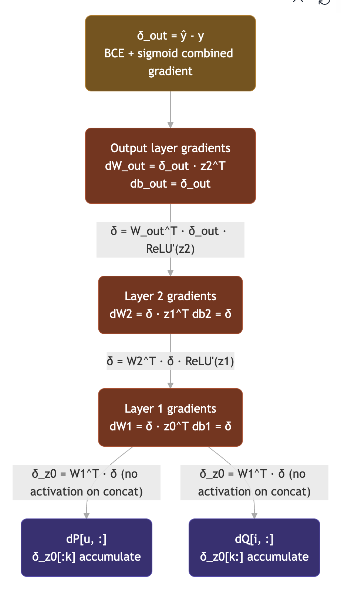
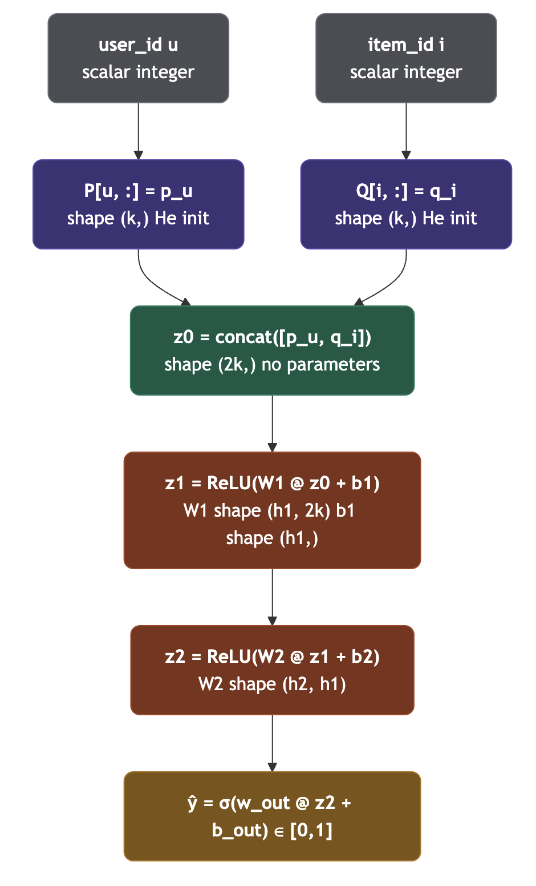

# Chapter 2 — Theoretical Foundations

## Chapter Overview

This chapter establishes the theoretical and mathematical foundations upon which the remainder of the thesis is built. It begins by formalising the recommendation problem and the distinction between explicit and implicit feedback, proceeds through the classical collaborative filtering paradigm and its neural generalisations, and concludes with the mathematics of backpropagation, hybrid recommendation, and the cold-start problem. The chapter is deliberately theoretical: it presents the Neural Collaborative Filtering (NCF) framework in its complete, general form — including the Generalized Matrix Factorization (GMF) pathway — as established in the literature. Where the implementation examined in later chapters (Chapters 6–8) realises only a subset of this general framework, that boundary is noted explicitly rather than left implicit, consistent with the transparency commitment stated in Chapter 1.

## 2.1 Recommendation Problem

### 2.1.1 Users and Items

Let $U = \{u_1, u_2, \dots, u_M\}$ denote a finite set of $M$ users and $I = \{i_1, i_2, \dots, i_N\}$ denote a finite set of $N$ items. Each user $u \in U$ and each item $i \in I$ is associated with a unique integer identifier, $u \in \{0, 1, \dots, M-1\}$ and $i \in \{0, 1, \dots, N-1\}$ respectively, following the contiguous zero-indexing convention required for embedding table lookups (Section 2.3.2). The recommendation task is, at its core, the problem of estimating a preference relationship between elements of $U$ and elements of $I$ using a limited history of observed interactions between them.

### 2.1.2 User–Item Interaction Matrix

The observed interaction history is represented as a matrix $Y \in \{0,1\}^{M \times N}$, where each entry $y_{ui}$ indicates whether an interaction between user $u$ and item $i$ has been observed:

$$
y_{ui} =
\begin{cases}
1, & \text{if an interaction } (u, i) \text{ has been observed} \\
0, & \text{otherwise}
\end{cases}
$$

A critical and frequently misunderstood property of $Y$ under implicit feedback (Section 2.1.3) is that $y_{ui} = 0$ does **not assert that user $u$ dislikes item $i$;** it asserts only that no interaction has been observed. The item may be unknown to the user, may not have been surfaced to them, or may simply reflect a future interaction not yet recorded. This distinction is fundamental to the design of the loss function and negative sampling strategy discussed in Sections 2.4.5 and 2.4.6.

For real-world catalogues, $Y$ is extremely sparse: the number of observed interactions is typically several orders of magnitude smaller than $M \times N$. This sparsity is a defining structural characteristic of the recommendation problem and motivates the use of low-dimensional latent representations (Section 2.2.3) rather than a direct, non-parametric model over the full $M \times N$ matrix.

### 2.1.3 Explicit and Implicit Feedback

User preference signals are conventionally classified into two categories. **Explicit feedback** consists of directly solicited preference judgements, most commonly numeric ratings on a fixed scale (e.g., 1–5 stars). Explicit feedback has the advantage of directly encoding preference _strength_ and _polarity_ (both positive and negative signal are available), but suffers from severe missing-not-at-random bias, since users disproportionately rate items they have already chosen to consume, and rating behaviour itself is optional and comparatively rare.

**Implicit feedback** consists of behavioural signals inferred from user actions — clicks, views, purchases, or, in the present study's dataset, the act of rating a film at all, independent of the rating's numeric value. Implicit feedback is available in far greater volume than explicit feedback, since it requires no additional user effort, but it is inherently one-sided: an observed interaction is a positive signal, while the absence of an interaction is ambiguous (Section 2.1.2) rather than a confirmed negative signal. This asymmetry necessitates the negative sampling procedures discussed in Section 2.4.5, and is the feedback regime addressed throughout this thesis: consistent with standard practice in implicit-feedback NCF research [1], the present study treats any recorded rating — irrespective of its numeric value — as a positive implicit interaction.

### 2.1.4 Rating Prediction vs Top-K Recommendation

Two distinct formulations of the recommendation problem exist in the literature. **Rating prediction** treats recommendation as a regression problem: given a user–item pair, predict the numeric rating the user would assign, typically evaluated using Root Mean Squared Error (RMSE) or Mean Absolute Error (MAE). This formulation is natural for explicit-feedback settings but is poorly suited to implicit feedback, where no numeric target exists.

**Top-$K$ recommendation** treats recommendation as a ranking problem: given a user, produce an ordered list of the $K$ items the user is most likely to interact with next, without requiring a calibrated numeric preference score. This formulation is the natural fit for implicit-feedback data and is the formulation adopted throughout this thesis. Under this formulation, the model's output $\hat{y}_{ui} \in (0,1)$ is interpreted as a relative score used to rank candidate items for a given user, rather than as a calibrated probability requiring interpretation in isolation. Evaluation accordingly uses ranking-based metrics — Hit Ratio and Normalised Discounted Cumulative Gain — rather than RMSE/MAE, as detailed in Chapter 8.

## 2.2 Collaborative Filtering

### 2.2.1 User-Based Collaborative Filtering

User-based collaborative filtering predicts a user's preference for an item by aggregating the preferences of _similar users_ for that item. Similarity between users $u$ and $v$ is typically computed over their respective rows of $Y$ (or, in explicit-feedback settings, over their rating vectors) using a similarity function such as cosine similarity or Pearson correlation. A predicted score for user $u$ and item $i$ is then computed as a similarity-weighted aggregate of the known preferences of $u$'s nearest neighbours for item $i$. While conceptually intuitive, user-based methods require computing and storing pairwise similarities across the full user population, an operation whose cost grows quadratically with $M$, rendering the approach impractical at the scale of millions of users.

### 2.2.2 Item-Based Collaborative Filtering

Item-based collaborative filtering inverts this logic, computing similarities between _items_ based on the pattern of users who have interacted with them, and recommending items similar to those a user has already engaged with. Because the number of items in many domains is more stable over time than the number of users, and because item–item similarity matrices can be precomputed offline, item-based methods historically offered better scalability and were adopted in early large-scale commercial systems. Both user-based and item-based methods remain **memory-based** approaches: they operate directly on the interaction matrix at prediction time rather than learning a compact parametric summary of it, a distinction that motivated the shift toward model-based methods described next.

### 2.2.3 Matrix Factorization

Matrix Factorization (MF) is the principal model-based collaborative filtering approach and remains a critical point of theoretical comparison for NCF. MF approximates the interaction matrix $Y$ as the product of two lower-rank latent factor matrices: a user-factor matrix $P \in \mathbb{R}^{M \times K}$ and an item-factor matrix $Q \in \mathbb{R}^{N \times K}$, where $K \ll \min(M, N)$ is the latent dimensionality. Each user $u$ is represented by a latent vector $p_u \in \mathbb{R}^K$ (the $u$-th row of $P$), and each item $i$ by a latent vector $q_i \in \mathbb{R}^K$. The predicted interaction score is the inner product of these vectors:

$$
\hat{y}_{ui} = p_u^{\top} q_i = \sum_{k=1}^{K} p_{uk} \, q_{ik}
$$

MF proved highly effective in explicit-feedback settings, most notably in the Netflix Prize competition, and can be extended to incorporate biases, temporal dynamics, and side information [2]. However, He et al. [1] formally demonstrate a structural limitation of the inner product as an interaction function: because the inner product is a linear, symmetric operator satisfying properties analogous to the triangle inequality in the induced latent space, it cannot represent every possible ranking of items for every user once the latent dimensionality $K$ is fixed and shared across the population. Increasing $K$ can mitigate this limitation but at the cost of overfitting and reduced generalisation on sparse data. This representational bottleneck — not a deficiency of latent-factor modelling in general, but specifically of the fixed bilinear inner-product interaction function — is the central motivation for the neural generalisation of MF presented in Section 2.4.

## 2.3 Neural Recommendation

### 2.3.1 Neural Networks

An artificial neural network is a parametric function composed of alternating linear transformations and non-linear activation functions, organised into layers. A single layer computes $z = \phi(Wx + b)$, where $x$ is the layer's input vector, $W$ and $b$ are learnable weight and bias parameters, and $\phi(\cdot)$ is a non-linear activation function applied element-wise. By composing multiple such layers, a neural network can approximate a broad class of continuous functions, a property formalised by the universal approximation theorem. In the recommendation context, neural networks are attractive precisely because they can, in principle, approximate interaction functions considerably more expressive than the fixed bilinear form used by MF (Section 2.2.3), while retaining a comparably compact, learnable parameterisation.

### 2.3.2 Embedding Representations

An embedding is a learned mapping from a discrete, categorical identifier (such as a user ID or item ID) to a dense, continuous vector representation. Formally, a user embedding matrix $P \in \mathbb{R}^{M \times K}$ and an item embedding matrix $Q \in \mathbb{R}^{N \times K}$ store one learnable $K$-dimensional vector per user and per item, respectively. Retrieving the embedding for a given identifier is a simple row-lookup operation, $p_u = P[u, :]$ and $q_i = Q[i, :]$, rather than a matrix multiplication against a one-hot encoded input vector — although the two operations are mathematically equivalent, since $P[u,:] = P^{\top} \mathbf{e}_u$ for the standard basis vector $\mathbf{e}_u$. The lookup formulation is computationally preferred because it avoids materialising and multiplying against a sparse one-hot vector of dimension $M$ or $N$.

A defining property of embedding layers, with direct implications for backpropagation (Section 2.5.4), is that their gradients are **sparse**: for a given training instance $(u, i)$, only the $u$-th row of $P$ and the $i$-th row of $Q$ receive a non-zero gradient contribution; all other rows are unaffected by that instance.

### 2.3.3 Multilayer Perceptrons

A Multilayer Perceptron (MLP) is a feedforward neural network composed of one or more hidden layers, each applying a linear transformation followed by a non-linear activation function, stacked between an input layer and an output layer. Given an input vector $z_0 \in \mathbb{R}^{d_0}$, an $L$-layer MLP computes:

$$
z_l = \phi\!\left(W_l^{\top} z_{l-1} + b_l\right), \quad l = 1, 2, \dots, L
$$

where $W_l \in \mathbb{R}^{d_{l-1} \times d_l}$ and $b_l \in \mathbb{R}^{d_l}$ are the learnable weight matrix and bias vector of layer $l$, and $\phi(\cdot)$ is a non-linear activation function (Rectified Linear Unit, ReLU, is used throughout this thesis: $\phi(x) = \max(0, x)$). In the recommendation context, an MLP is applied not to raw item features but to a **concatenation** of user and item embedding vectors, allowing the network to learn arbitrary interactions between the two embedding spaces rather than being restricted to the element-wise or inner-product interactions available to MF.

### 2.3.4 Nonlinear Representation Learning

The motivation for introducing non-linearity into the interaction function is representational, not merely empirical. A linear function of the concatenated embeddings $[p_u ; q_i]$ — for example, a single linear layer with no activation — remains fundamentally limited in the class of functions it can represent, since the composition of linear operations is itself linear. The introduction of non-linear activations between layers allows the composed function $f(u, i \mid \Theta)$ to approximate non-linear decision boundaries in the joint embedding space, in principle enabling it to capture higher-order feature interactions that a bilinear form (Section 2.2.3) structurally cannot express. This capacity for non-linear representation learning is the theoretical basis for the MLP pathway of the NCF framework introduced in the next section, and is the specific mechanism realised by the implementation examined in Chapters 6–8.

## 2.4 Neural Collaborative Filtering

Having established the representational limitation of MF (Section 2.2.3) and the representational capacity of neural networks (Section 2.3), this section presents the Neural Collaborative Filtering framework of He et al. [1] in its complete, general form.

### 2.4.1 Generalized Matrix Factorization

Generalized Matrix Factorization (GMF) is the first of the two pathways comprising the full NCF framework. GMF generalises the MF inner product by replacing it with an element-wise (Hadamard) product followed by a _learnable_ linear projection, rather than the fixed, unweighted summation implicit in the inner product. Let $p_u^{G} \in \mathbb{R}^{K}$ and $q_i^{G} \in \mathbb{R}^{K}$ denote GMF-specific embedding vectors for user $u$ and item $i$. The GMF pathway output is:

$$
\phi^{\text{GMF}}(u, i) = p_u^{G} \odot q_i^{G}
$$

where $\odot$ denotes the Hadamard (element-wise) product. Standard MF is recovered as a special case of GMF when the subsequent projection weight vector $h^G$ (Section 2.4.3) is fixed to a constant vector of ones and no activation is applied to the projection. By instead allowing $h^G$ to be learned, GMF generalises MF to a data-adaptive, per-dimension weighting of the element-wise interaction — a strict generalisation that retains the interpretability of the latent-factor interaction while relaxing MF's fixed-weighting assumption.

### 2.4.2 MLP-Based Collaborative Filtering

The second pathway applies the MLP formalism of Section 2.3.3 directly to the recommendation problem. Distinct, MLP-specific embedding vectors $p_u^{M} \in \mathbb{R}^{K}$ and $q_i^{M} \in \mathbb{R}^{K}$ are concatenated to form the input to the MLP tower:

$$
z_0 = \left[p_u^{M} \, ; \, q_i^{M}\right] \in \mathbb{R}^{2K}
$$

and the MLP output is $\phi^{\text{MLP}}(u,i) = z_L$, computed by the layer-wise recursion of Section 2.3.3. The use of _separate_ embedding tables for the GMF and MLP pathways — rather than a single shared embedding table feeding both — is a deliberate design choice in the general NCF framework: it allows each pathway to learn a representation optimised for its own interaction function (element-wise product versus non-linear composition), rather than forcing a single embedding space to serve both purposes simultaneously.

### 2.4.3 Neural Matrix Factorization

The complete NCF architecture, termed NeuMF (Neural Matrix Factorization), fuses the GMF and MLP pathways by concatenating their respective output vectors and applying a final learned linear projection to a scalar score:

$$
\hat{y}_{ui} = \sigma\!\left(h^{\top}\left[\phi^{\text{GMF}}(u,i) \, ; \, \phi^{\text{MLP}}(u,i)\right]\right)
$$

where $h \in \mathbb{R}^{K + d_L}$ is a learnable weight vector (with $d_L$ the dimensionality of the final MLP layer) and $\sigma(\cdot)$ is the logistic sigmoid function (Section 2.4.4), ensuring $\hat{y}_{ui} \in (0,1)$. The NeuMF fusion is designed to combine the linear, interpretable interaction modelling of GMF with the non-linear representational capacity of the MLP pathway, under the hypothesis that the two pathways capture complementary aspects of user–item compatibility.

**Scope note.** Section 2.4.1–2.4.3 presents the _complete_ theoretical NCF/NeuMF architecture as established in the literature. As stated in Chapter 1 and detailed fully in Chapter 6, the implementation developed and evaluated in this thesis realises the MLP pathway described in Section 2.4.2 in isolation — a single shared embedding table feeding a concatenation-based MLP tower — and does not implement the GMF pathway or the NeuMF fusion layer described here. This theoretical section is retained in full because it is necessary background for understanding the design space within which the implemented variant sits, and because it clarifies precisely which portion of the general framework the empirical chapters of this thesis do and do not provide evidence for.

### 2.4.4 NCF Prediction Function

Independent of whether the interaction function $f$ is realised by GMF, an MLP, or their NeuMF fusion, the general NCF prediction function is:

$$
\hat{y}_{ui} = f(u, i \mid \Theta) = \sigma\!\left(f'(u,i\mid\Theta')\right)
$$

where $f'$ denotes the pre-activation score (logit) produced by the chosen interaction architecture, $\Theta$ is the complete set of learnable parameters (embeddings and network weights), and $\sigma(x) = \frac{1}{1+e^{-x}}$ is the logistic sigmoid function, which maps the unbounded logit onto the interval $(0,1)$, suitable for interpretation as an interaction probability under the Binary Cross-Entropy loss defined next.

### 2.4.5 Loss Function

Because the recommendation problem under implicit feedback is treated as binary classification over user–item pairs (Section 2.1.3), NCF is trained by minimising the Binary Cross-Entropy (BCE) loss between the predicted score $\hat{y}_{ui}$ and the binary label $y_{ui}$:

$$
\mathcal{L}(y_{ui}, \hat{y}_{ui}) = -\left[y_{ui} \log(\hat{y}_{ui}) + (1 - y_{ui}) \log(1 - \hat{y}_{ui})\right]
$$

Summed over the training set of observed positive interactions $Y$ and a set of sampled negative instances $Y^{-}$ (Section 2.4.6), the total training objective is:

$$
\mathcal{L} = -\sum_{(u,i) \in Y \cup Y^{-}} \left[y_{ui} \log(\hat{y}_{ui}) + (1-y_{ui})\log(1-\hat{y}_{ui})\right]
$$

BCE is the natural loss function for this formulation because it directly corresponds to the negative log-likelihood of a Bernoulli-distributed interaction indicator under the model's predicted probability $\hat{y}_{ui}$, providing a principled probabilistic interpretation of the training objective consistent with the binary classification framing of Section 2.1.4.

### 2.4.6 Optimisation

**Negative sampling.** As established in Section 2.1.3, only positive interactions are directly observed in $Y$. Training a discriminative model such as NCF nonetheless requires contrastive negative examples. The standard approach, and the one adopted throughout this thesis, is to sample, for each observed positive interaction $(u, i)$, a fixed number of items $i^{-}$ with which $u$ has _not_ interacted, uniformly at random from the unobserved portion of $u$'s row in $Y$, and to assign these pairs a label $y_{u i^{-}} = 0$. The ratio of negative to positive samples per positive instance is a hyperparameter; He et al. [1] report favourable empirical performance in the range of 3–6 negatives per positive.

**Gradient-based optimisation.** Given the loss function of Section 2.4.5, the parameters $\Theta$ are updated iteratively via gradient descent: $\Theta \leftarrow \Theta - \eta \nabla_{\Theta} \mathcal{L}$, where $\eta$ is the learning rate. In practice, adaptive per-parameter learning-rate methods — most notably Adam [Kingma & Ba, 2015] — are preferred over plain stochastic gradient descent (SGD) for NCF-style models, owing to the sparse, per-instance gradient updates induced by the embedding layers (Section 2.3.2): Adam's per-parameter moment estimates allow infrequently updated embedding rows to receive appropriately scaled updates when they are eventually touched, a property that plain SGD lacks. The complete mechanics of gradient-based parameter updates, including the derivation of the gradients required to implement Adam and SGD from first principles, are presented in Section 2.5.5 and realised in the from-scratch implementation of Chapter 6.

## 2.5 Backpropagation

### 2.5.1 Computational Graphs

A computational graph is a directed acyclic graph representation of a composite function, in which nodes represent elementary operations (e.g., matrix multiplication, addition, activation functions) and edges represent the flow of intermediate values between operations. Representing the NCF forward pass as a computational graph — embedding lookup, concatenation, a sequence of linear-plus-activation layers, and a final loss computation — makes explicit the sequence of intermediate quantities that must be cached during the forward pass and subsequently traversed, in reverse, during backpropagation. Figure 2.1 illustrates the forward computational graph for the MLP-based interaction function examined in this thesis; Figure 2.2 illustrates the corresponding backward graph.

### 2.5.2 Forward Propagation

Forward propagation is the process of evaluating the computational graph in topological order, from inputs to output, computing and caching each intermediate value required for the subsequent backward pass. For the MLP-based NCF interaction function, forward propagation proceeds as: (1) embedding lookup, $p_u = P[u,:]$, $q_i = Q[i,:]$; (2) concatenation, $z_0 = [p_u ; q_i]$; (3) layer-wise application of $z_l = \phi(W_l^{\top} z_{l-1} + b_l)$ for $l = 1, \dots, L$; and (4) computation of the loss $\mathcal{L}(y_{ui}, \hat{y}_{ui})$ given the ground-truth label. Each layer's input must be cached during this pass, since it is required to compute that layer's weight gradient during backpropagation (Section 2.5.4).

{width=\columnwidth}

### 2.5.3 Reverse-Mode Differentiation

Backpropagation is an efficient application of the chain rule of calculus, implemented via reverse-mode automatic (or, in the from-scratch case, manual) differentiation over the computational graph. Rather than computing the gradient of the loss with respect to each parameter independently — which would require redundant recomputation of shared intermediate terms — reverse-mode differentiation computes and propagates a single "upstream gradient" backward through the graph, from the loss to the inputs, reusing each intermediate gradient (commonly denoted $\delta_l = \partial \mathcal{L} / \partial z_l$) across all parameters that depend on it. This reuse is what makes backpropagation computationally efficient relative to naively differentiating each parameter in isolation, and it is the algorithmic principle underlying both PyTorch's automatic differentiation engine and the manual backward-pass implementation developed in Chapter 6.

### 2.5.4 Gradient Computation

**Loss gradient.** For the sigmoid–BCE composition used throughout this thesis, the gradient of the loss with respect to the pre-activation logit $s_{ui}$ (i.e., $\hat y_{ui} = \sigma(s_{ui})$) admits a notably simple closed form:

$$
\frac{\partial \mathcal{L}}{\partial s_{ui}} = \hat{y}_{ui} - y_{ui}
$$

This simplification arises because the derivative of the sigmoid, $\sigma'(x) = \sigma(x)(1-\sigma(x))$, cancels algebraically against the $1/\hat{y}$ and $1/(1-\hat{y})$ terms produced by differentiating the BCE loss with respect to $\hat{y}_{ui}$. Computing the combined gradient directly on the logit, rather than composing the two derivatives separately at runtime, is both mathematically equivalent and numerically preferable, since it avoids the loss of precision that can occur when $\hat{y}_{ui}$ approaches $0$ or $1$.

**Linear layer gradients.** For a linear layer $z_l = W_l^{\top} z_{l-1} + b_l$ with incoming upstream gradient $\delta_l = \partial \mathcal{L}/\partial z_l$ (after the corresponding activation-function gradient has already been applied, see below), the parameter and input gradients are:

$$
\frac{\partial \mathcal{L}}{\partial W_l} = z_{l-1} \, \delta_l^{\top}, \qquad
\frac{\partial \mathcal{L}}{\partial b_l} = \delta_l, \qquad
\delta_{l-1} = W_l \, \delta_l
$$

The weight gradient is an outer product of the layer's cached input (Section 2.5.2) and the upstream gradient; the gradient passed to the preceding layer, $\delta_{l-1}$, is obtained by projecting the upstream gradient back through the transpose of the weight matrix.

**Activation gradients.** For the ReLU activation used in the hidden layers, the local gradient is the indicator of positivity of the pre-activation input: $\text{ReLU}'(x) = 1$ if $x > 0$, else $0$. The upstream gradient is passed through element-wise, masked by this indicator — intuitively, gradient flows only through units that were active during the forward pass.

**Embedding gradients.** Because the embedding lookup operation selects a single row of the embedding matrix, its gradient is inherently **sparse**: given an upstream gradient $\delta_p \in \mathbb{R}^K$ arriving at the output of the user-embedding lookup for user $u$, only the $u$-th row of the gradient matrix $\partial \mathcal{L}/\partial P$ is updated, via direct assignment (or accumulation, across a mini-batch containing repeated occurrences of $u$):

$$
\frac{\partial \mathcal{L}}{\partial P[u,:]} \mathrel{+}= \delta_p
$$

with all other rows of $\partial \mathcal{L}/\partial P$ unaffected by this training instance. The analogous relation holds for the item embedding matrix $Q$.

### 2.5.5 Parameter Updates

Given the accumulated gradients of Section 2.5.4, parameters are updated using a gradient-based optimisation rule. Under plain SGD with momentum, a velocity term $v$ is maintained per parameter tensor and updated as $v \leftarrow \mu v - \eta g$, followed by the parameter update $\theta \leftarrow \theta + v$, where $\mu$ is the momentum coefficient, $\eta$ the learning rate, and $g$ the gradient. Under Adam, first and second raw moment estimates of the gradient are maintained and bias-corrected:

$$
m \leftarrow \beta_1 m + (1-\beta_1) g, \qquad
v \leftarrow \beta_2 v + (1-\beta_2) g^2
$$

$$
\hat{m} = \frac{m}{1-\beta_1^t}, \qquad \hat{v} = \frac{v}{1-\beta_2^t}, \qquad
\theta \leftarrow \theta - \eta \frac{\hat{m}}{\sqrt{\hat{v}} + \epsilon}
$$

where $t$ is the current optimisation step and $\epsilon$ is a small constant preventing division by zero. Adam's per-parameter adaptive scaling is particularly well suited to the sparse gradient regime of embedding layers (Section 2.5.4), since infrequently updated embedding rows retain informative moment estimates between updates, allowing them to receive proportionally larger effective learning rates than would a fixed global learning rate under plain SGD.

## 2.6 Hybrid Recommendation

### 2.6.1 Content-Based Recommendation

Content-based recommendation derives a preference score from the attributes of items themselves, rather than from collaborative interaction patterns. A common formulation represents each item $i$ as a feature vector $x_i$ (e.g., a binary or TF-IDF-weighted vector over a categorical attribute space such as genre), constructs a user profile vector $x_u$ as an aggregate — commonly the mean — of the feature vectors of items the user has previously engaged with, and scores candidate items by the similarity, typically cosine similarity, between the user profile and the candidate item's feature vector:

$$
\text{score}_{\text{content}}(u, i) = \frac{x_u \cdot x_i}{\|x_u\| \, \|x_i\|}
$$

Content-based recommendation has the notable advantage of requiring no interaction history for the _item_ — a new item can be scored immediately once its attributes are known — but it is limited by the granularity and informativeness of the available item features, and it does not directly exploit collaborative signal across users.

### 2.6.2 Popularity-Based Recommendation

Popularity-based recommendation scores items purely by their aggregate interaction frequency across the entire user population, independent of any individual user's history:

$$
\text{score}_{\text{pop}}(i) = \frac{\log(1 + \text{count}(i))}{\log(1 + \max_j \text{count}(j))}
$$

The logarithmic transformation is a standard damping mechanism that compresses the score range for very high-frequency ("blockbuster") items relative to a raw linear count, preventing a small number of extremely popular items from dominating recommendations to a degree disproportionate to their actual relative popularity. Popularity-based scoring requires no personalisation signal whatsoever and is therefore trivially applicable to any user, including one with no interaction history at all — a property directly relevant to the cold-start problem discussed in Section 2.7.

### 2.6.3 Collaborative Recommendation

Collaborative recommendation, as established in Sections 2.2 and 2.4, derives a preference score from patterns of interaction across the user–item matrix, without direct reference to item content attributes. Its principal strength — the ability to surface non-obvious associations that content similarity alone would not reveal — is also the source of its principal weakness: collaborative signal is only informative once a meaningful number of interactions have been observed for the user and item in question, motivating the hybrid strategies discussed next.

### 2.6.4 Hybrid Recommendation

A hybrid recommendation strategy combines two or more of the signal types above to compensate for the individual weaknesses of each. A common and theoretically well-motivated hybridisation scheme, and the one adopted in this thesis (Chapter 9), is a **weighted linear combination**, in which the collaborative (NCF) score and a cold-start score (itself a combination of popularity and content signals) are blended according to a mixing coefficient $\alpha$ that depends on the richness of the target user's interaction history:

$$
\text{score}(u,i) = \alpha \cdot \text{score}_{\text{NCF}}(u,i) + (1-\alpha)\cdot\text{score}_{\text{cold}}(u,i), \qquad \alpha \in [0,1]
$$

with $\alpha$ typically defined as a monotonically increasing function of the number of observed interactions for user $u$, such that $\alpha \to 0$ as interaction history vanishes (favouring the cold-start signal) and $\alpha \to 1$ once sufficient interaction history has accumulated (favouring the collaborative signal). This scheme is a pragmatic, computationally simple alternative to more theoretically elaborate approaches — such as a learned gating function, or a Bayesian Personalised Ranking-style formulation [14] — that could in principle learn the mixing behaviour rather than fixing its functional form a priori.

## 2.7 Cold-Start Problem

### 2.7.1 New User Cold Start

The **new-user cold-start problem** arises when a user has no, or very few, recorded interactions, such that the collaborative model has insufficient evidence to have learned a meaningful embedding $p_u$ for that user (indeed, if the user was not present in the training data at all, no embedding row exists for them under a fixed-vocabulary embedding table). Under such conditions, a collaborative model's predictions are effectively untrained noise. The hybrid formulation of Section 2.6.4 addresses this directly by setting $\alpha \approx 0$ for such users, deferring entirely to popularity- and content-based scoring until sufficient interaction history accumulates.

### 2.7.2 New Item Cold Start

The **new-item cold-start problem** is the structural mirror of the new-user case: an item with no, or very few, recorded interactions has an untrained (or non-existent) item embedding $q_i$, and collaborative scoring involving that item is correspondingly unreliable. Because item attributes (e.g., genre) are typically known at the time an item is added to a catalogue — unlike a new user's preferences, which are unknown by definition — content-based scoring (Section 2.6.1) is particularly well suited to the new-item case, since it can produce a meaningful similarity score for the new item immediately, without requiring any accumulated interaction history for that item specifically.

### 2.7.3 Sparse Interaction Problem

More broadly than the binary new-user/new-item cases, the **sparse interaction problem** refers to the general condition — pervasive in real interaction matrices (Section 2.1.2) — in which the majority of users and items have interaction counts far below what would be required for a purely collaborative model to learn well-generalised embeddings, even if they are not, strictly speaking, entirely new to the system. The interaction-count-dependent $\alpha$ schedule of Section 2.6.4 generalises naturally to this continuum: rather than a hard binary switch between "cold" and "warm" treatment, the mixing coefficient interpolates smoothly as a function of accumulated interaction count, providing a graceful degradation from popularity/content-dominated scoring at low interaction counts to collaborative-dominated scoring as a user's history becomes sufficiently rich for the trained NCF embeddings to be informative.

## Chapter Summary

This chapter has established the theoretical apparatus required for the remainder of the thesis: a formal statement of the recommendation problem under implicit feedback; the progression from memory-based collaborative filtering through matrix factorization to the neural generalisation offered by NCF, presented in its complete GMF+MLP NeuMF form; the mathematics of forward propagation and backpropagation required to train such a model from first principles; and the theoretical basis for hybrid, content-based, and popularity-based recommendation as a response to the cold-start problem. Two points established here recur throughout the thesis and are worth restating explicitly. First, the notation introduced in this chapter — $U, I, Y, y_{ui}, P, Q, p_u, q_i, \hat{y}_{ui}, \mathcal{L}, \Theta$ — is used consistently in all subsequent chapters. Second, the general NCF/NeuMF framework of Section 2.4 is broader than the specific architecture implemented and empirically evaluated later in this thesis; Chapter 6 makes explicit which components of this theoretical framework were actually realised in code.

---
